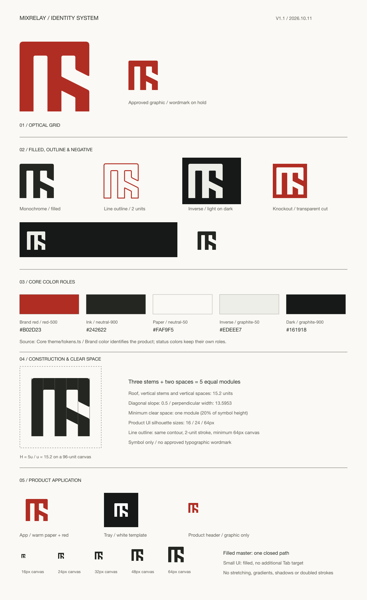

# MixRelay 아이덴티티

2026-10-12. **Optical Grid 심벌과 Optical 워드마크를 확정했다.**
[워드마크 SVG·사용 규격](wordmark/README.md)과
[단일 AI 마스터](../wordmark-study/plex/mixrelay-plex-wordmark.ai)를 저장소에 보관한다.
제품 소스는 현재 심벌 전용 구현이다. 아래 심벌 규격과 앱·트레이 아이콘 계약은 유지한다.
심벌 형태는 `source/symbol.json`, 색과 UI 크기는 Core `tokens.ts`의
`brandColors / brandSizes`, 공통 표현은 `BrandIdentity`가 소유한다.



## 색과 테마

| 역할 | Core 참조 | 웹 값 | 사용 |
| --- | --- | --- | --- |
| Primary | red-500 | `#B02D23` | 고정 조직 빨강, 기본 심벌 |
| Ink | neutral-900 | `#242622` | 밝은 바탕의 단색 |
| Paper | neutral-50 | `#FAF9F5` | 앱 아이콘·문서 바탕 |
| Inverse | graphite-50 | `#EDEEE7` | 어두운 바탕의 밝은 심벌 |
| Dark | graphite-900 | `#161918` | 반전 바탕 |
| White | brandColors.white | `#FFFFFF` | 트레이·순백 출력 |

Core `primary`는 고정 빨강, `neutral`은 테마의 텍스트 역할, `inverse`는 밝은 고정색이다.
CSS는 `--brand-primary / --brand-ink / --brand-inverse`를 소비한다.
빨강 심벌은 실행·선택·녹음·오류 상태를 표시하지 않는다.

## 형태와 보호 여백

- SVG 캔버스 96×96, 실제 실루엣 (10,10)–(86,86), 76×76 정사각형.
- 모듈 u=15.2. 세 기둥 + 두 빈칸 = 5u. 상단 연결부도 u.
- 사선 기울기 0.5, 사선 획과 틈의 수직 폭 약 13.5953, 세로 단면 u.
- 심벌은 겹치는 조각과 stroke 없는 하나의 닫힌 채움 path다.
- 접선 이동량은 외곽 상단 4, 내부 상단 2, 사선 끝 1.8, 내부 접합 0.8이다.
  밑면은 직선이다. 이 광학 보정을 공통 원형 반지름으로 바꾸지 않는다.
- 보호 여백은 실제 심벌 높이 H의 0.2배 = 1u. 96 캔버스 내부의 10단위 여백에
  더해 외부 배치에서도 필요한 여백을 확보한다.
- 워드마크는 승인된 Optical path를 사용한다. M/R/l 높이 = 심벌 실루엣 H,
  공통 기준선, 심벌–M의 실제 빈 간격 = 0.26H. y 꼬리와 곡선의 overshoot를 보존한다.
  조합 크기는 실제 시안에 맞추고 SVG 전체 캔버스 높이를 H로 취급하지 않는다.

## 채움·아웃라인·반전

| 파일 | 의미 | 최소 SVG 캔버스 | 사용 |
| --- | --- | --- | --- |
| `symbols/mixrelay-red.svg` | 빨강 채움 | 16px | 앱 UI·웹·favicon |
| `symbols/mixrelay-mono.svg` | 중립 채움 | 16px | 단색 출력 |
| `symbols/mixrelay-inverse.svg` | 밝은 채움 | 16px | 어두운 바탕 |
| `symbols/mixrelay-white.svg` | 순백 채움 | 16px | 트레이·순백 출력 |
| `symbols/mixrelay-outline-{red,mono,inverse}.svg` | 선형 아웃라인 | 64px | 큰 문서·그래픽 |
| `symbols/mixrelay-knockout-{red,mono,inverse}.svg` | 면에서 심벌을 비운 음각 | 32px | 바탕색이 드러나는 투명 반전 |

아웃라인은 같은 윤곽의 2단위 stroke·round join이며 크기와 함께 선도 확대한다.
작은 헤더·트레이에는 채움형을 사용한다. 인쇄용 면 확장이 필요하면 복사본에서 수행한다.
음각은 `fill-rule="evenodd"` 컴파운드 path의 실제 투명 구멍이다.
반전은 색·면의 반전이며 좌우·상하로 뒤집지 않는다.
늘리기·기울이기·임의 두께·별도 테두리·그라디언트·그림자를 추가하지 않는다.

## 아이콘과 제품 적용

- Core compact·standard·display: 실제 실루엣 16·24·64px. 모두 정사각형 심벌만 표시한다.
  아웃라인은 display로 제한하고 선이 잘리지 않도록 viewBox 여유를 둔다.
- `ProductHeading`은 h1와 접근성 이름 MixRelay를 유지한다. 펼친/접힌 앱 헤더 모두
  같은 심벌이며 로고는 Tab 정지점이나 버튼이 아니다.
- `RuntimeConnection` 설치·연결 안내는 standard를 사용한다.
- 앱 아이콘: macOS 앱 아이콘 템플릿을 따른다. 1024px 투명 캔버스 가운데에 824px
  연속 곡률 Paper 타일을 두고 템플릿 그림자(아래 10px, 흐림 10px, 검정 30%)를 넣는다.
  빨강 실루엣은 528px이며 타일 안 사방 148px 여백을 둔다. 마스크가 없는 macOS 14·15도
  다른 앱과 같은 모양으로 보이고, 이후 macOS는 같은 타일을 다시 마스크한다. 심벌 자체에는
  그림자나 별도 틀을 추가하지 않는다. 제거 앱은 같은 타일에 Ink 실루엣을 쓴다.
- 트레이: 실루엣에 맞춰 자른 순백 템플릿, macOS가 표시 색을 결정한다.
- 앱·Dock·설치·Linux/Windows 패키지 아이콘과 32/64/512px 트레이는 같은 원본에서 생성한다.
- 웹 헤더·푸터와 앱·웹 favicon도 같은 심벌이다. 링크의 MixRelay 홈 접근성 이름은 유지한다.
- Storybook `Core/Identity/Brand`, `Core/Design System/Foundations`에서 테마·축소·아웃라인·
  제품 헤더·좁은 긴 번역과 실제 앱/트레이 파일을 확인한다.
- 타 앱 노드의 실제 아이콘과 오디오 실행·녹음·오류 상태 규격은 별도 소유자에 따른다.

## 키트와 재생성

[키트 ZIP](mixrelay-symbol-kit.zip)을 제공한다. `kit/svg`에 10종 심벌, 앱·트레이 SVG를 제공한다. `kit/png`는 투명 바탕 PNG다.
채움형 16/24/32/64/128/256/512/1024px, 아웃라인 64/128/256/512px,
음각 32/64/128/256/512px를 제공한다. `kit/app`은 앱 PNG·ICNS·ICO,
`kit/tray`는 트레이 PNG다. 이 ZIP은 심벌 전용 키트이며,
승인 워드마크 SVG는 별도 `wordmark/`에 있다. 보류 시안은 제품 자산이 아니다.

```sh
pnpm branding:kit
```

`branding/build.mjs`가 동일 기하·Core 색에서 SVG·가이드·manifest를 생성하고,
Tauri의 기존 렌더러가 앱·플랫폼 아이콘과 PNG를 생성한다. PNG를 직접 수정하지 않는다.
`mixrelay-brand-system.svg / mixrelay-symbol-kit.ai`는 확정 심벌의 편집 문서이며 설명 텍스트만 일반 서체다.
AI는 Illustrator에서 저장하며 SVG 재생성이 AI를 덮어쓰지 않는다.

이전 가로 로고와 배포 워드마크는 [보류 기록](../wordmark-study/on-hold/README.md)에
옮겼다. 레터링 A·B도 보류 연구 기록이며 제품 자산이 아니다.
중복 조사 범위는 [조사 기록](../logo-study/research/review.json),
검증 범위와 실제 설치본 미확인은 [검증 기록](verification.md)에 구별한다.
