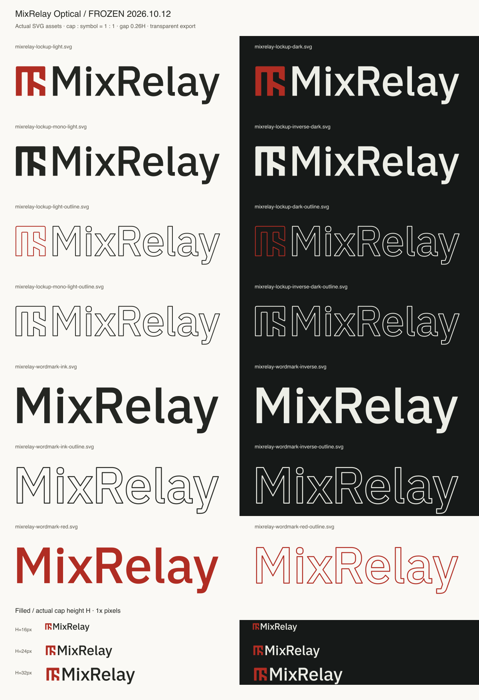

# MixRelay Optical · 동결 에셋

2026-10-12 사용자 승인. Optical 한 안을 사용한다.
[AI 편집 마스터](../../wordmark-study/plex/mixrelay-plex-wordmark.ai)는 기존 단일 파일이며,
[글자 path 원본](../source/wordmark.json)과 [심벌 원본](../source/symbol.json)을 함께 보관한다.



## 파일과 색

모든 SVG는 투명 바탕, 실제 벡터 path다. 글꼴 설치·외부 파일·텍스트 렌더링에 의존하지 않는다.

| 용도 | 채움형 | 아웃라인 |
| --- | --- | --- |
| 라이트 컬러 | `mixrelay-lockup-light.svg` | `mixrelay-lockup-light-outline.svg` |
| 다크 컬러 | `mixrelay-lockup-dark.svg` | `mixrelay-lockup-dark-outline.svg` |
| 라이트 단색 | `mixrelay-lockup-mono-light.svg` | `mixrelay-lockup-mono-light-outline.svg` |
| 다크 반전 | `mixrelay-lockup-inverse-dark.svg` | `mixrelay-lockup-inverse-dark-outline.svg` |
| 글자만 Ink | `mixrelay-wordmark-ink.svg` | `mixrelay-wordmark-ink-outline.svg` |
| 글자만 Inverse | `mixrelay-wordmark-inverse.svg` | `mixrelay-wordmark-inverse-outline.svg` |
| 글자만 빨강 | `mixrelay-wordmark-red.svg` | `mixrelay-wordmark-red-outline.svg` |

색 소유자는 Core `apps/control-ui/src/core/theme/tokens.ts#brandColors`다.
라이트 컬러는 Primary `#b02d23` + Ink `#242622`, 다크 컬러는 같은 Primary +
Inverse `#edeee7`이다. 반전은 밝은 단색이며 좌우·상하로 뒤집지 않는다.
CSS filter로 변형하지 않고 해당 테마의 파일을 사용한다.
Paper `#faf9f5`와 Dark `#161918`는 검토판의 바탕이며 SVG에는 넣지 않는다.

## 비례와 실제 배치 크기

- 심벌 실루엣 높이 H = M/R/l cap 높이 = 76단위. 상단과 기준선은 일치한다.
- 심벌 오른쪽부터 M 왼쪽 잉크까지 0.26H = 19.76단위.
- y 꼬리는 기준선 아래 0.28653H. e/a의 곡선 overshoot도 그대로 둔다.
- 조합의 채움 잉크 폭은 526.28149단위, y를 포함한 높이는 97.77650단위다.
- 보호 여백 0.2H = 15.2단위를 사방에 포함한다.
  같은 viewBox를 채움·아웃라인·테마 전체에 사용하므로 교체 시 배치가 움직이지 않는다.
- **실제 표시 크기는 제품 시안에 맞춘다.** SVG 기본 width/height를 UI 크기로 채택하지 않는다.
  필요한 H(px)에 대해 전체 SVG 너비는 `7.324756 × H`, 높이는 `1.686533 × H`다.
  예를 들어 H=24px이면 전체 캔버스는 약 175.79×40.48px이며 심벌과 cap은 24px다.
  `height:24px`를 SVG 전체에 주면 cap은 약 14.23px가 되므로 구별한다.
- 글자와 심벌을 별도로 늘리거나 내부 간격을 다시 조절하지 않는다.
  독립 심벌은 기존 `../symbols/` 자산을 사용한다. 앱·트레이 아이콘은 기존 정사각형 규격을 유지한다.

아웃라인은 **심벌과 글자 모두** `fill="none"`, 2단위 stroke, round join이다.
크기와 함께 선도 확대한다. 인쇄용 선 확장은 복사본에서 수행한다.
채움형은 H≥16px, 아웃라인은 H≥64px를 보수적인 사용 기준으로 둔다.
작은 앱 헤더에는 채움형을 쓴다. 이 기준은 정적 SVG 검토이며 실제 설치본 검증은 별도다.

## 재생성과 검증

```sh
node branding/build-wordmark.mjs
```

`branding/build.mjs`에도 연결했다. 빌드는 동결 path와 현재 Core 색을 읽고,
AI 마스터 해시가 승인 시점과 달라지면 재검토를 요구한다. AI 파일을 덮어쓰지 않는다.
[manifest.json](manifest.json)에 비례·색·원본 AI·SVG의 SHA-256을 기록한다.
[verification.json](verification.json)에 구조·원본 일치·재생성 검증 결과를 기록했다.
원본 Plex 폰트는 수정하거나 서브셋하지 않았다. OFL과 출처는 Core fonts 폴더에 보관한다.
현행 제품 화면 적용 여부와 에셋 준비 완료를 구별한다.
