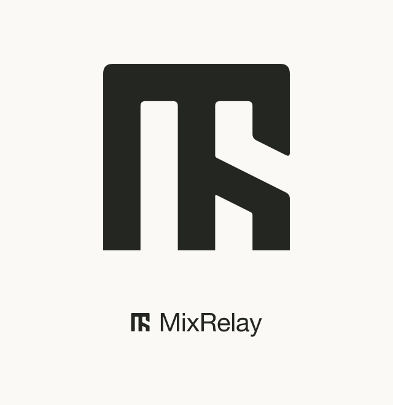

# MixRelay 로고

2026-10-11, 사용자가 우측 **B · Optical Grid**를 선택했다. 선택 당시 외곽선을
변경하지 않고 하나의 원본과 색상별 자산으로 정리했다.

## 규격

- 정사각형 외곽 76×76, SVG 캔버스 96×96.
- 세 기둥·두 세로 틈·상단 연결부는 모두 15.2. 검은 획과 빈칸의 직선 비율은 1:1.
- 사선 채움과 틈은 사선에 수직으로 약 13.5953, 세로 방향 단면은 15.2.
  사선 기울기는 0.5이며 오른쪽 위아래 세로 빈칸의 길이도 각각 15.2다.
  모서리 곡선을 넣기 전의 기하 규격이며 곡선 부근의 단면은 달라진다.
- 심벌은 겹치는 조각과 stroke가 없는 **한 개의 닫힌 채움 path**.
- 외곽 위쪽 접선 이동량 4, 내부 위쪽 2, 사선 끝 1.8, 내부 접합부 0.8, 밑면 0.
  모서리는 2차 베지어이며 원형 반지름 규격이 아니다.
- 현행 색은 Core `brandColors`를 소비한다: 중립 `#242622`, 빨강 `#b02d23`, 반전 `#edeee7`.
- 워드마크는 Helvetica Neue Regular 윤곽, 100pt 기준 자간 -1.2.

## 자산과 원본

- `symbols/mixrelay-{mono,red,inverse}.svg`: 투명 배경 심벌 3개.
- `lockups/mixrelay-{mono,red,inverse}.svg`: 심벌과 윤곽 워드마크의 가로 조합 3개.
- `preview.svg` / `.png`: 선택한 심벌과 가로 조합.
- `sizes.svg` / `.png`: 실제 16/24/32/48/96px 캔버스 축소와 색상 확인.
- `../identity/source/wordmark.json`, `../identity/source/outline.swift`: 현행 워드마크 윤곽과 추출 소스.
- `build.cjs`, `manifest.json`: 현행 `../identity/source`와 Core 색을 소비하는 조사 프리뷰 생성기.
- `research/search-symbol.png`: 이번 연결형 심벌의 512px 흑백 검색 이미지.
- `research/review.json`: 이번 조사 조건·후보·관찰·미확인 범위.
- `research/previous-a/`: 이전 분리형 A 조사 기록과 당시 검색 이미지·조회 화면.
  이번 연결형 심벌의 검색 결과와 구별해 보존했다.

`node branding/logo-study/build.cjs`로 자산을 재생성한다. Sharp는 이 작업 환경의
번들 런타임 경로를 사용한다. 탈락한 시안과 중간 비교판 79개를 제거했으며
삭제한 폴더에 의존하지 않고 재생성되는지 확인했다.

## 검증과 조사 상태

선택 당시 B안과 현재 심벌의 path가 정확히 같음을 확인했다. 독립 SVG 6개의 XML,
심벌 path 수, 닫힌 윤곽, 외부 참조 없음, 16–96px 축소·반전·빨강을 확인했다.
16px에서도 사선 개구부가 남지만 별도 픽셀 도안은 만들지 않았다.

새 심벌의 TMview 이미지 검색은 전체 상품류 990건, 9류 191건, 42류 110건을 반환했다.
9류와 42류 각각 첫 페이지 30개 중 표시 가능한 도형을 비교했다. 누락 이미지와
나머지 페이지는 검토하지 않았다. 많은 결과가 단순 쐐기·띠 형태로 검색 적합성이 낮아,
상위 결과에 없다는 사실만으로 유사 도형이 없다고 판단하지 않았다.

확인 범위에서 완전히 같은 로고는 발견하지 못했다. 가장 주의할 구조적 후보는
[Meizu의 EU 도형 상표 012350501](https://euipo.europa.eu/eSearch/#details/trademarks/012350501)이다.
EUIPO 원부에서 등록 상태, 2033-11-28 만료일, 2023년 갱신과 9류 지정상품을 직접 확인했다.
소프트웨어·음악 파일·헤드폰을 포함하며, 상단 연결과 두 세로 채널 구성을 공유한다.
Meizu는 넓은 사각형·좁은 채널·사선 없음, MixRelay는 정사각형·같은 획과 틈·우측 사선이라는
차이가 있다. 법률상 충돌 여부를 판단한 결과는 아니다.

공식 자료의 MIDIRack MR 모노그램과 Greenlines Studios의 공개 MR 디자인도 비교했다.
글자와 음악 분야 또는 모노그램 발상을 공유하지만 실제 외곽과 내부 구성은 달랐다.
상세 관찰·출처·실제 조회 화면은 [조사 기록](research/review.json)에 남겼다.
이전 분리형 A 조사와 이번 연결형 B 조사는 구별해서 보존했다.

디자인 선택과 제품 적용은 완료했다. [현행 브랜드 규격](../identity/README.md)에서
컬러·아웃라인·반전·실제 소비자를 관리한다. 여기의 조사 증거는 당시 조회 기록이다.
확인 범위에서 같은 도형은 발견하지 못했으며, 법률상 사용 가능성을 확정한 자료는 아니다.
TMview는 참여 관청 데이터로 모든 등록·미등록 권리를 망라하지 않는다.
