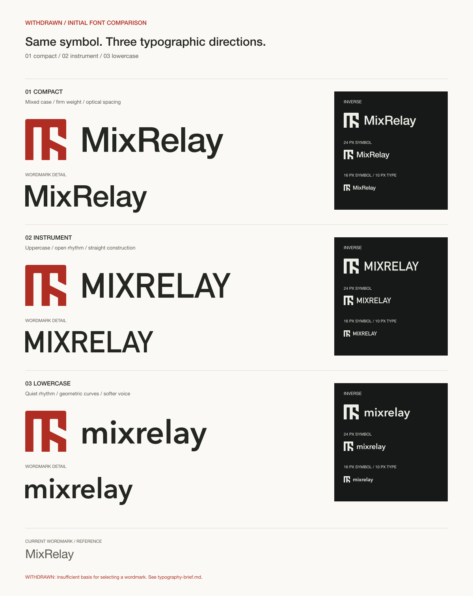

# MixRelay 워드마크 검토

2026-10-12에 확정 Plex UI 서체를 기준으로 탐색을 재개했다.
현재 동결 마스터는 [Plex 워드마크 AI](plex/mixrelay-plex-wordmark.ai) 하나에 정리했으며
Optical만 남겼다. [현행 이미지](plex/optical.png)와
[설계 근거](typography-brief.md#plex-워드마크-초안--2026-10-12)를 함께 확인한다.
높이·기준선 수정: M/R/l을 심벌 실루엣의 위·아래에 맞추고 y만 아래로 내려오게 했다.
심벌–글자 간격은 리뷰 후 승인된 0.26H를 AI 마스터와 검토 표본에 적용했다.
탈락안과 이전 비교 표본을 정리하고 세 대지의 단일안으로 통일했다.
사용자 승인으로 Optical을 동결했다. 제품용 SVG·정규화된 글자 원본과 사용 규격은
[공식 워드마크 에셋](../identity/wordmark/README.md)을 따른다.
현행 앱 화면 적용은 별도 작업이며 아래는 이전 보류 기록이다.

**2026-10-11: 워드마크 전체 보류. 그래픽 심벌만 확정했고 제품과 배포 키트에서 글자를 제거했다.**
[이전 배포 자산 보관](on-hold/README.md).

보류 시안은 [직접 그린 레터링 A·B](lettering-v2/README.md)다. 여덟 글자의 윤곽과
간격을 직접 구성했으며 아래의 초기 폰트 비교와 구별해 보관한다.

**세 안과 DIN 추천을 철회했다.** 설치된 글꼴의 굵기·자간·대소문자를 바꾼 비교로,
조직의 브랜드 체계와 실제 글자 형태를 근거로 한 워드마크 설계가 부족했다.
아래는 철회한 초기 비교 기록이다. 현행 검토 기준은 [타이포그래피 설계 근거](typography-brief.md)다.

2026-10-11. 심벌 B / Optical Grid와 조직 빨강은 유지하고 워드마크를 다시 검토한다.
현재 제품 자산의 Helvetica Neue Regular는 최종 타이포 선택이 아니다.
이 폴더의 세 안은 비교용이며 제품·웹·기존 Illustrator 브랜드 문서를 덮어쓰지 않는다.



| 안 | 기반 글꼴·표기 | 방향 | 판단 |
| --- | --- | --- | --- |
| 1 Compact | Helvetica Neue Medium · MixRelay | 기존 이름 표기를 유지하고 굵기와 글자 사이를 정돈 | 가장 익숙하지만 일반 소프트웨어 로고에 가까움 |
| 2 Instrument | DIN Alternate Bold · MIXRELAY | 직선 중심의 대문자, 일정한 높이, 열린 내부 공간 | 추천 철회: 장비라는 인상만으로 선택 근거가 부족함 |
| 3 Lowercase | Avenir Next Demi Bold · mixrelay | 소문자와 기하적 곡선, 짧은 가로 폭 | 차분하지만 심벌보다 부드러운 인상이 강함 |

세 안은 기존 글꼴을 기반으로 자간과 조합을 조정한 시안이다. 글자 자체를 새로 그린
독자 서체라고 표기하지 않는다. Monome·TX-6의 절제된 도구 인상을 참고하되 특정
제품의 로고를 복제하지 않는다. 이 비교는 새 워드마크의 상표 검색 결과를 의미하지 않는다.

## 비교 조건

- 모든 로고의 심벌 path는 `../identity/source/symbol.json`과 동일하다.
- 색은 Core `tokens.ts`의 `brandColors`에서 읽는다.
- 심벌 높이 H, 글자의 기준선 위 실제 높이 0.6H, 간격 0.4H. 글자는 수평으로 늘리거나 줄이지 않는다.
- 기준선은 심벌 상단에서 0.8H. 소문자 y의 내려오는 부분은 별도로 보존한다.
- 비교 시 대문자·소문자의 서로 다른 잉크 높이를 실측해 정렬한다.
- 각 글자 쌍의 자간 조정은 JSON `pairAdjustments`에 기록한다.
- 오른쪽 패널은 반전형, 심벌 24px, 심벌 16px + 글자 높이 10px를 실제 픽셀 크기로 표시한다.
- 아웃라인 SVG는 선택한 심벌의 기존 2단위 선을 사용하고 글자는 채움 윤곽으로 유지한다. 심벌 64px 이상에서 사용한다.

## 파일과 재생성

`comparison.svg / comparison.png`는 전체 비교판이다. 각 안의 `*-primary.svg`,
`*-mono.svg`, `*-inverse.svg`, `*-outline.svg`는 가로 조합이고,
`*-wordmark.svg`는 글자만 있는 파일이다. 로고 글자는 모두 path로 변환했다.
안별 JSON에는 원본 글꼴명·자간·글자별 bounds·벡터 윤곽이 남아 있다.

macOS CoreText로 윤곽을 다시 추출할 때:

```sh
swift branding/wordmark-study/outline.swift branding/wordmark-study/01-compact.json HelveticaNeue-Medium MixRelay -1.1 '{"Mi":-0.3,"ix":-0.2,"xR":1.1,"Re":-0.5,"la":0.3,"ay":-0.8}'
swift branding/wordmark-study/outline.swift branding/wordmark-study/02-instrument.json DINAlternate-Bold MIXRELAY 1.2 '{"IX":-0.5,"XR":-0.6,"RE":-0.6,"EL":-0.3,"LA":-1.8,"AY":-1.1}'
swift branding/wordmark-study/outline.swift branding/wordmark-study/03-lowercase.json AvenirNext-DemiBold mixrelay -0.6 '{"ix":-0.3,"xr":0.5,"re":-0.9,"la":0.1,"ay":-0.8}'
node branding/wordmark-study/build.mjs
```

CoreText가 다른 글꼴로 대체하면 추출을 중단한다. 이미 저장한 JSON에서 SVG를 만들 때는
글꼴 설치가 필요 없다. `comparison.png`는 같은 SVG를 렌더링한 미리보기다.

## 리뷰

- 조합 · 기존 글자는 심벌과 같은 대문자 높이를 사용 · 두 형태가 서로 경쟁 · 글자 높이를 0.6H로 낮추고 같은 조건으로 비교.
- 1번 · 혼합 대소문자와 강한 R이 익숙함 · 읽기 쉽지만 개성이 약함 · 기본 이름 표기를 유지할 경우 후보로 남김.
- 2번 · 대문자 직선의 장비 인상만 평가 · 이름 체계와 개별 글자 검토가 빠짐 · 추천 철회, 채택 후보로 취급하지 않음.
- 3번 · 곡선과 소문자 비중이 큼 · 친근하지만 심벌의 단단함과 차이 · 부드러운 제품 인상을 원할 때 후보로 남김.

SVG 렌더링에서 잘림·겹침 없이 큰 조합과 실제 작은 크기·반전형을 확인했다.
제품 UI와 본문 Inter는 이번 검토에서 변경하지 않았다.
