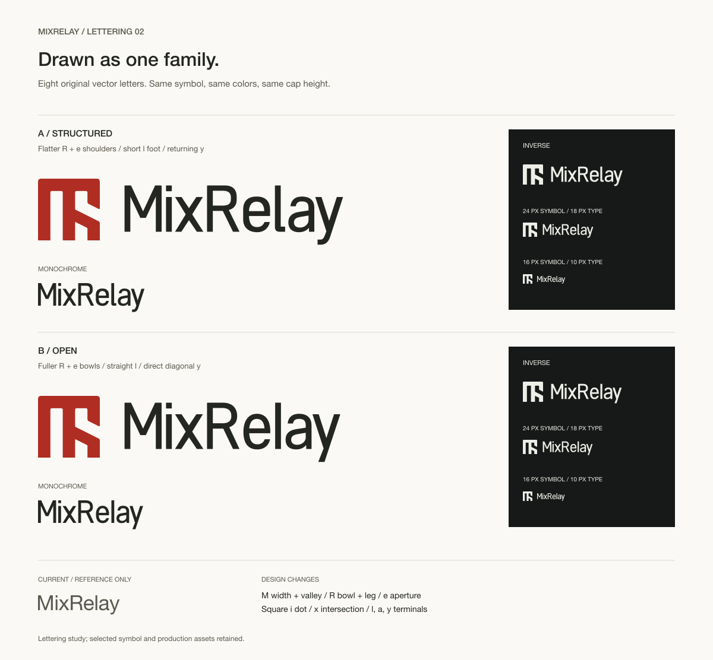

# MixRelay 레터링 A·B

2026-10-11. 사용자 결정으로 워드마크 전체 보류. 그래픽 심벌만 확정했으며 이 폴더는 연구 기록이다. `MixRelay`의 여덟 글자를 직접 그린
벡터 윤곽이다. 설치 글꼴을 바꿔 넣거나 폰트 윤곽을 변형해 후보를 만들지 않았다.
전체 알파벳을 갖춘 서체가 아니라 제품 이름을 위한 레터링이다.

## 같은 구조 안에서 달라지는 부분

선택한 Optical Grid 심벌과 Core `brandColors`를 함께 사용한다. A·B는 M·i·x와
기본 높이·획 체계를 공유하고 R·e·l·a·y의 윤곽과 글자쌍 간격을 달리한다.

| 글자 | 공통 설계 | A / Structured | B / Open |
| --- | --- | --- | --- |
| M | 폭 80, 높이 100. 기존의 넓은 폭과 깊은 V를 줄이고 내부 골을 올림 | 공통 | 공통 |
| i | 세로획과 같은 12.5 크기의 사각 점, 점과 몸통 분리 | 공통 | 공통 |
| x | 교차 중심과 사선 폭을 직접 구성 | 공통 | 공통 |
| R | 휘어진 다리를 직선 사선으로 교체 | 평평한 어깨와 짧은 수직 옆면 | 연속 곡선의 더 열린 볼 |
| e | 입구 13, 가로획 10.5. 세로획보다 가볍게 구성 | 중앙 옆면에 직선 구간 | 연속 곡선 |
| l | 대문자와 같은 높이 | 짧은 받침으로 식별 | 곧은 수직 끝 |
| a | 2층 구조, 아래 속공간 확대 | 단정한 위쪽 어깨 | 조금 더 충실한 위쪽 곡선 |
| y | 내려오는 높이 28, 사선 팔 | 짧은 돌아오는 꼬리 | 곧은 사선 꼬리 |

[글자별 기존·A·B 비교](details.png)에 M·R·e·y를 같은 대문자 높이로 배치했다.
기존 비교 윤곽만 Helvetica Neue Regular이며 새 후보 여덟 글자는 모두
`source.json`에 독립 path로 기록했다. R·e·a 속공간은 실제 투명한 구멍이다.

대문자 높이 100, 소문자 높이 75, 기본 세로획 12.5를 기준으로 한다.
사선과 곡선의 검은 면은 이 기준에 맞춰 따로 구성하며 모든 획에 같은 수치를
강제로 넣지 않는다. 심벌의 획/틈 1:1 규칙도 문자에 그대로 옮기지 않는다.

## 간격과 조합

| 안 | Mi | ix | xR | Re | el | la | ay | 전체 폭 |
| --- | ---: | ---: | ---: | ---: | ---: | ---: | ---: | ---: |
| A | 9.5 | 7 | 8 | 8 | 10.5 | 7 | 2 | 471.5 |
| B | 9.5 | 7 | 8 | 8.5 | 10.5 | 10 | 2 | 465.5 |

수치는 대문자 100 좌표계에서 글자 잉크 박스 사이 거리다. 사선이 만드는 실제
빈 공간을 큰 조합과 축소에서 함께 봤다. 초안의 `ay` 7은 벌어져 보여 2로 줄였다.
동일 tracking으로 한 번에 조절하지 않았다.

검토 조합은 심벌 H, 대문자 높이 0.75H, 간격 0.4H, 기준선 0.86H다.
[제품군·크기 비교](context.png)에는 실제 Sonolog 탐색 자산과 나란한 배치,
0.65H·0.75H·0.85H, 밝은 바탕과 반전의 실제 작은 크기를 넣었다.
0.75H가 심벌과 이름의 무게를 더 균형 있게 연결한다는 현재 판단이며
최종 제품 규격으로 적용한 수치가 아니다. Sonolog 참고 자산도 최종 승인된
조직 서체로 취급하지 않는다. 출처는 `sonolog-reference.json`에 보관했다.

## 자체 리뷰와 확인

- A R·e 옆면 · 짧은 평면이 심벌의 수직·수평 면과 이어짐 · 조합이 더 단단하게 보임 · 우선 발전시킬 안으로 판단.
- B l·y · 직선 끝이 더 간결함 · 이름 끝의 기계적 인상이 강하고 l 식별은 A보다 약함 · 두 끝 처리를 비교 선택할 수 있게 보존.
- ay · 초안에서 마지막 쌍이 떨어져 보임 · 이름 끝의 리듬이 느슨해짐 · 두 안 모두 잉크 박스 간격을 7에서 2로 축소.
- 축소 · 심벌 16px/대문자 10px와 24px/18px를 밝은 바탕·반전에서 확인 · 10px에서는 속공간이 매우 작아짐 · 10px를 넘겨 더 줄이는 사용은 권장하지 않음; 실제 제품 적용 시 설치본 검증 필요.

14개 SVG를 XML로 확인했다. 후보 자산마다 여덟 글자가 독립 path이며 이미지나
글꼴 참조가 없다. 가로 조합의 심벌 path는 선택한 원본과 동일하고 글자 박스가
겹치지 않는다. PNG 렌더링과 Illustrator 가져오기에서 글자 구멍·배치·반전을 확인했다.
현행 심벌·워드마크 원본과 브랜드 AI 문서는 작업 전후 SHA-256이 같다.
제품 UI·본문 서체·배포 자산은 이번 시안에서 수정하지 않았다.

## 파일

- `comparison.svg / comparison.png`: A·B 조합, 단색, 반전, 축소.
- `details.svg / details.png`: 기존 형태와 새 글자, 글자쌍 간격.
- `context.svg / context.png`: Sonolog 옆의 제품군 배치와 높이·크기 비교.
- `review.svg`: 위 세 비교판을 합친 편집 가능한 벡터 문서.
- [mixrelay-lettering-review.ai](mixrelay-lettering-review.ai): Illustrator에서 저장한 세 대지 문서. 비교·글자·제품군 배치를 나눴고 새 레터링은 글자별 편집 가능한 path다. 저장 완료 상태와 원본 배치를 확인했다.
- `a-*.svg / b-*.svg`: primary·mono·inverse·outline·wordmark. 아웃라인은 기존 심벌의 2단위 선형 버전이며 글자는 채움 윤곽이다. 심벌 64px 이상에서 사용한다.
- `source.json`: 직접 그린 글자 윤곽·수치·변형·간격의 원본.
- `manifest.json`: 조합·색·글자별 수정 근거와 검토 상태.

SVG 재생성: `node branding/wordmark-study/lettering-v2/build.mjs`.
로고 자산 재생성에는 글꼴 설치가 필요 없다. 설명 라벨만 시스템 산세리프를 사용한다.
최종 안의 선택과 제품 교체는 별도 결정이며 초기 세 폰트 비교는 계속 철회 상태다.
